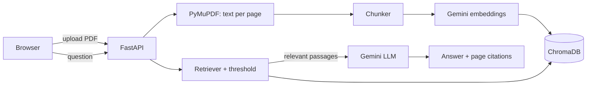

# DocChat: Chat with Your Documents


Upload PDFs, ask questions, and get answers **grounded in your documents**, each with the exact page as evidence. If the answer isn't in the documents, the app says so instead of guessing.

## Features

- PDF upload with validation (type, size, page limit) and duplicate detection
- Page-aware chunking with overlap, so every answer can cite a page
- Semantic search with Gemini embeddings and ChromaDB
- Grounded answers: a similarity threshold plus a strict LLM prompt; citations come from stored metadata, not from the model
- "Not found in your documents" when nothing relevant exists
- Evidence cards (page, snippet, match strength), document list, delete, per-document scope
- Mobile-first dark UI, keyboard accessible
- Rate limiting, security headers, input validation, tests and CI

## How it works



1. **Ingest:** extract text page by page, split into overlapping chunks (each chunk stays on one page), embed, and store with filename and page metadata.
2. **Retrieve:** embed the question, find the closest chunks, and refuse early if nothing passes the similarity threshold.
3. **Answer:** send only the relevant passages to the LLM with strict rules (answer only from context, ignore instructions inside documents). Sources shown to the user come from the database metadata, so the model cannot invent a page number.

## Quick start

Requires Python 3.10+ and a free [Gemini API key](https://aistudio.google.com/app/apikey).

```powershell
git clone https://github.com/sherakram/docchat-rag-assistant.git
cd docchat-rag-assistant
python -m venv .venv
.\.venv\Scripts\Activate.ps1        # macOS/Linux: source .venv/bin/activate
pip install -r requirements.txt
copy .env.example .env              # macOS/Linux: cp .env.example .env
# edit .env and set GEMINI_API_KEY
uvicorn backend.main:app --reload
```

Open http://127.0.0.1:8000. Interactive API docs are at `/docs`.

## Configuration

Set in `.env`. See `.env.example` for the full list.

| Variable | Default | Purpose |
|---|---|---|
| `GEMINI_API_KEY` | none | Required. Never commit it. |
| `GEMINI_CHAT_MODEL` | `gemini-3.5-flash-lite` | Model names change often; override here |
| `MIN_SIMILARITY` | `0.5` | Below this, the app answers "not found" without calling the LLM |
| `CHUNK_SIZE_WORDS` / `CHUNK_OVERLAP_WORDS` | `200` / `40` | Re-upload documents after changing |
| `MAX_UPLOAD_MB` / `MAX_PDF_PAGES` | `10` / `200` | Upload limits |
| `CHAT_RATE_LIMIT` / `UPLOAD_RATE_LIMIT` | `20` / `5` per minute | Per client IP |

## API

| Method | Path | Purpose |
|---|---|---|
| POST | `/api/upload` | Upload and index a PDF |
| GET | `/api/documents` | List documents |
| DELETE | `/api/documents/{doc_id}` | Delete a document and its chunks |
| POST | `/api/chat` | Ask a question (optional `doc_id` scope) |
| POST | `/api/search` | Retrieval only, for debugging |
| GET | `/api/health` | Health check |

## Project structure

```
backend/   FastAPI app, services (pdf_loader, chunker, embeddings, vector_store, retriever, llm, chat), tests
frontend/  index.html, styles.css, app.js (no build step)
scripts/   evaluation and debugging tools
eval/      evaluation question set
```

## Testing and evaluation

```powershell
python -m pytest -v                  # unit and API tests, no network or API key needed
python -m scripts.evaluate           # retrieval quality on eval/questions.json
```

Results on my evaluation set ([0%] in-scope and [100%] out-of-scope questions over [DOCUMENT NAMES]):

| Chunk size | Recall@4 | Out-of-scope refused | Threshold |
|---|---|---|---|
| [200 words] | [fill in] | [fill in] | [0.xx] |
| [other size] | [fill in] | [fill in] | [0.xx] |

## Security notes

- API keys live only in `.env` on the backend and are never sent to the browser or logged
- Uploaded files are stored under random IDs, never user-supplied names; document IDs are validated before touching the filesystem
- Model and document text is rendered with `textContent`, never as HTML, plus a Content-Security-Policy
- Rate limits on endpoints that cost API quota

## Limitations

- Text-based PDFs only (no OCR for scans)
- No user accounts: anyone who can open the app can see and delete all documents, so do not expose it publicly as is
- Each question is independent (no chat history)
- Rate limiter is in-memory and per process
- Using the free Gemini tier means document text is sent to Google: upload only non-sensitive files

## Roadmap

OCR for scanned PDFs, streaming answers, chat history, user accounts, sentence-aware chunking, hybrid keyword and vector search.

## License

MIT